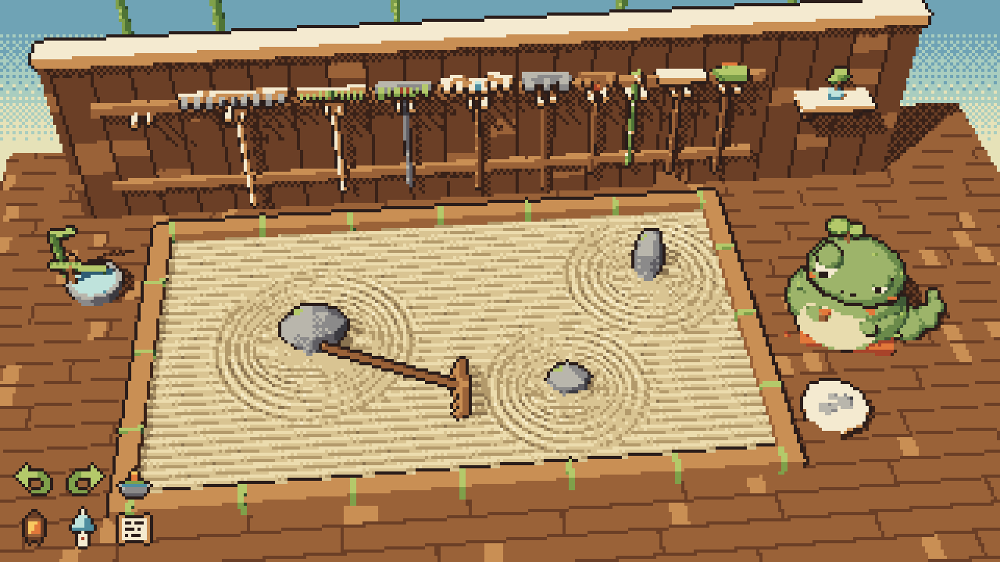
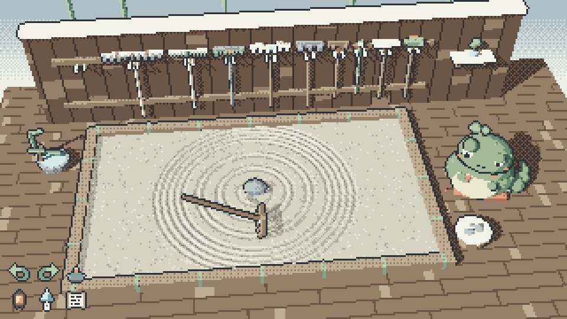
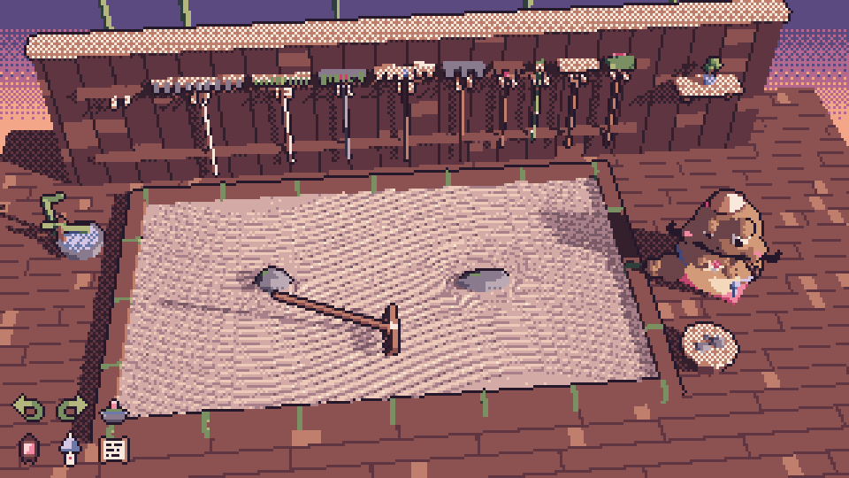
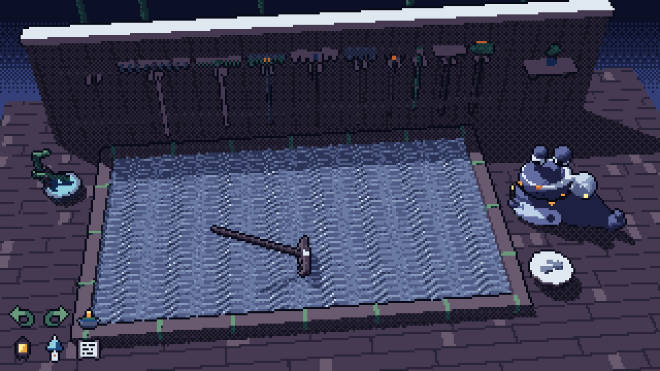
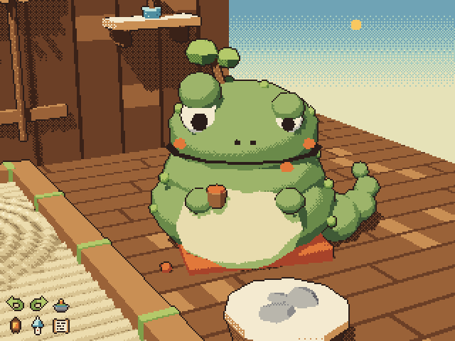
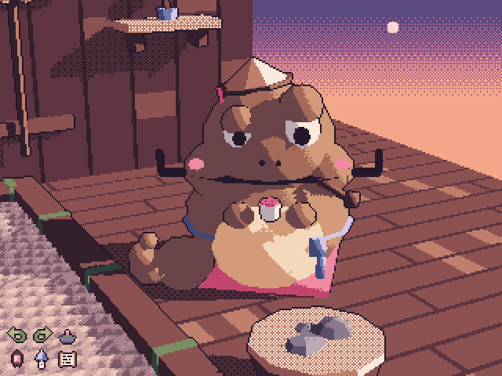
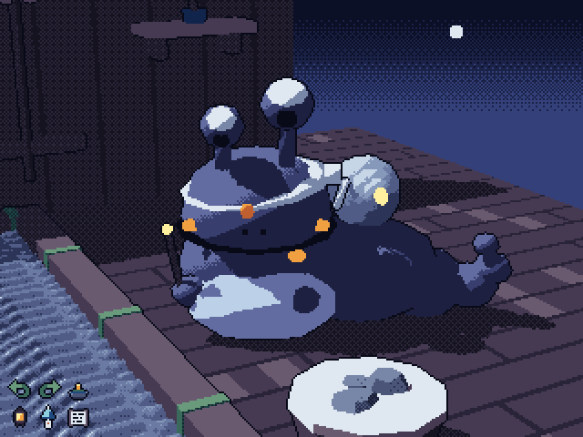

# Gubba's Porch

**A quiet 3D 8-bit Zen garden for the browser.**
No timers. No scores. No rush. Just warm cedar, raked sand, gentle retro chimes, and Gubba.

### [Enter the Garden →](https://zeapsu.github.io/gubbas-porch/)

 

---

## Pull up a seat on the engawa

Step onto the wooden porch, pick any rake off the timber wall, and draw slow grooves through the sand. Stones gently part the lines around them like water, a bamboo *shishi-odoshi* tips in the corner, and Gubba lounges nearby with a cup of tea — offering an unhurried remark now and then, or sitting in complete silence if you prefer.

- **Ten tools on the wall** — from the classic five-tine *Sugi* and wide nine-tine *Ōnami* to the ripple-making *Mikazuki*, twin-prong *Wa* for circling stones, flat *Nagi*, and the *Hōki* broom to sweep the whole bed smooth again.
- **Stones, moss & lanterns** — open the wicker basket beside Gubba to place, drag, or clear stones, moss cushions, water basins, bonsai, and stone lanterns.
- **Gentle retro soundscape** — soft chiptune melodies tuned to Japanese pentatonic scales, crunching sand that responds to your stroke speed, wind chimes, and optional rain.
- **Optional breath guide** — tap the lotus in the corner for a slow, quiet breathing rhythm (`4-4-6`, `4-7-8`, or `Box`) that Gubba breathes along with.
- **Saves right where you left it** — your garden stays in your browser, or export a crisp pixel-art PNG postcard anytime.

---

## Four times of day

The porch follows your local clock automatically, or switch moods anytime from the lantern icon or Settings.

<table>
  <tr>
    <td align="center" width="33%">
       
      <strong>Morning Mist</strong> — soft low sun &amp; drifting mist
    </td>
    <td align="center" width="33%">
       
      <strong>Sakura Dusk</strong> — long amber shadows &amp; drifting petals
    </td>
    <td align="center" width="33%">
       
      <strong>Moonlit Koi Pond</strong> — fireflies &amp; warm lantern glow
    </td>
  </tr>
</table>

---

## Meet Gubba

Swap Gubba's look anytime in **Settings → Look** — or tap Gubba on the porch to say hello.

<table>
  <tr>
    <td align="center" width="33%">
       
      <strong>Moss Gubba</strong> — tiny bonsai sprout &amp; warm tea
    </td>
    <td align="center" width="33%">
       
      <strong>Kasa Gubba</strong> — woven sun hat &amp; sleepy grin
    </td>
    <td align="center" width="33%">
       
      <strong>Lantern Gubba</strong> — glowing shell under the moon
    </td>
  </tr>
</table>

---

## Quiet Controls

| Action | Mouse / Touch | Keyboard |
| --- | --- | --- |
| **Rake sand** | Drag across the sand bed | — |
| **Switch rake** | Click / tap a rake on the wall (hold on touch to read its description) | `1` – `9` |
| **Sweep bed smooth** | Hold the *Hōki* broom on the wall | Hold `0` |
| **Place / move / remove stones** | Click / tap the stone basket; tap or drag on sand to place; drag stones to move (off bed to remove) | `B` |
| **Orbit & zoom** | Drag on the deck or sky; scroll / two-finger pinch & drag | `C` cycles Cozy 3/4, Top-Down & Gubba Porch |
| **Undo / Redo** | Bottom-left arrow icons | `Z` / `Y` |
| **Settings, Mood, Breath, Sound** | Bottom-left scroll, lantern, lotus, and bell icons | `Esc` · `M` (mute) · `Space` (breath) |

---

Built with calm pixels and zero tracking. Curious how the porch is put together? See <a href="docs/DEVELOPMENT.md">Development &amp; Architecture</a> and <a href="DESIGN.md">DESIGN.md</a>.

